<div align="center">

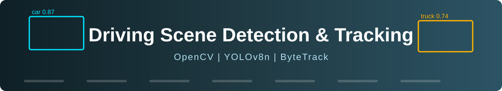

### 🚗 🚦 🚌 🚚 🚶 &nbsp;Seeing the road the way a self-driving car does&nbsp; 🛣️

<p>
  
  
  
  
</p>
<p>
  
  
  
  
</p>

**[📌 Overview](#-overview) • [🧠 How it works](#-how-it-works) • [🏆 Results](#-results) • [📊 Charts](#-charts) • [⚠️ Limitations](#️-limitations) • [💻 Run it](#-run-it-yourself)**

</div>

---

## 📌 Overview

This project analyses **dashcam driving videos (BDD100K)** and **detects + tracks road objects** such as 🚗 cars, 🚚 trucks, 🚌 buses, 🚶 people and 🚦 traffic lights.

It blends two worlds of computer vision:

| 🧰 Classical Computer Vision | 🧠 Deep Learning |
|---|---|
| Gaussian blur → grayscale → adaptive threshold → contours (**OpenCV**) | Real-time detection with **YOLOv8n** and persistent IDs with **ByteTrack** |

It then measures ⚡ **speed (FPS)**, 📦 **objects per frame**, 🏷️ **classes found**, 🎚️ **detection confidence** and ⏱️ **track lifetimes**, and compares them across different videos.

---

## 🧠 How it works

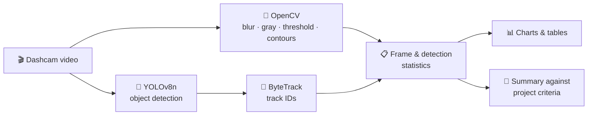

<details>
<summary><b>🔄 Click to see the full notebook workflow (24 steps)</b></summary>

<br/>

| Step | What happens |
|:---:|---|
| 1️⃣ – 3️⃣ | 📦 Install · ⚙️ configure · 🤖 load and warm up YOLOv8n |
| 3️⃣b | 🖥️ Record Python / package versions and CPU/GPU |
| 4️⃣ – 6️⃣ | 🎲 Pick 5 random videos · 🛠️ process 150 frames each · 💾 save CSV files |
| 7️⃣ – 1️⃣2️⃣ | 📋 Summary table · 🖼️ sample frames · ⚡ FPS · 📦 detections per frame · 🏷️ classes · 🎚️ confidence |
| 1️⃣3️⃣ – 1️⃣4️⃣ | 📷 *(optional)* run detection on your own images |
| 1️⃣5️⃣ | 🏁 Conclusion against the project's own criteria |
| 1️⃣6️⃣ – 2️⃣1️⃣ | 🆚 Per-video comparison · 📉 confidence histogram · 🔥 class heatmap · ⏱️ track lifetime · 🐢 speed vs busyness |
| 2️⃣2️⃣ – 2️⃣4️⃣ | 🧐 Possible false detections · 📋 final comparison table · 🎓 limitations |

</details>

---

## 🏆 Results

> 📝 Saved results from the author's run on **Kaggle (Tesla T4 GPU)**. Your numbers will differ a little because videos are chosen randomly and hardware varies.

<div align="center">

| 🎞️ Videos | 🖼️ Frames | ⚡ Avg. speed | 🎚️ Avg. confidence | ⚠️ Low-conf. (< 0.4) |
|:---:|:---:|:---:|:---:|:---:|
| **5** | **750** | **51.4 FPS** | **0.548** | **20.8 %** |

</div>

### 🆚 Per-video comparison

| 🎬 Video | 📦 Objects / frame | 🎚️ Mean confidence | 🎯 Unique tracks | ⚡ FPS | 🔲 Contours / frame |
|:---:|:---:|:---:|:---:|:---:|:---:|
| 0 | 10.63 | 0.514 | 46 | 44.4 | 77 |
| 1 | 4.87 | 0.607 | 29 | 52.2 | 14 |
| 2 | 2.59 | 0.500 | 39 | 53.4 | 4 |
| 3 | 8.63 | 0.570 | 55 | 48.7 | 27 |
| 4 | 0.21 | 0.620 | 5 | 58.5 | 24 |

### 🏁 Summary against the project's own criteria

| 🎯 Criterion *(chosen by the author, not a universal standard)* | 📏 Target | 📈 Measured | ✅ / ❌ |
|---|:---:|:---:|:---:|
| ⚡ Processing speed | ≥ 20 FPS | 51.4 FPS | ✅ |
| 🔴 Share of low-confidence detections | < 50 % | 20.8 % | ✅ |
| 🎚️ Spread of mean confidence across videos | < 0.08 | 0.120 | ❌ |

**Notebook verdict:** 🟠 **MIXED** — fast, but the mean confidence differs noticeably between videos. Mean confidence ranges from 0.500 (video 2) to 0.620 (video 4).

> 🚗 **Most detected classes:** cars by a wide margin, then traffic lights and trucks, followed by buses and people.

### 🖥️ Environment of the saved run

| 🔧 Item | 📌 Value |
|---|---|
| 🐍 Python | 3.13 |
| 🎮 Device | GPU – Tesla T4 |
| 🤖 ultralytics | 8.4.208 |
| 👁️ opencv-python | 4.14.0.94 |
| 🔢 numpy / 🐼 pandas | 2.1.3 / 2.3.3 |
| 📊 matplotlib | 3.10.0 |
| 🔥 torch | 2.11.0+cu128 |

> ⏱️ **FPS definition:** time for OpenCV preprocessing **+** YOLO/ByteTrack tracking. It **excludes** video reading and writing.

---

## 📊 Charts

<div align="center">

| ⚡ Processing speed per frame | 📦 Detections per frame |
|:---:|:---:|
| 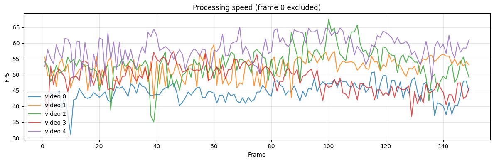 | 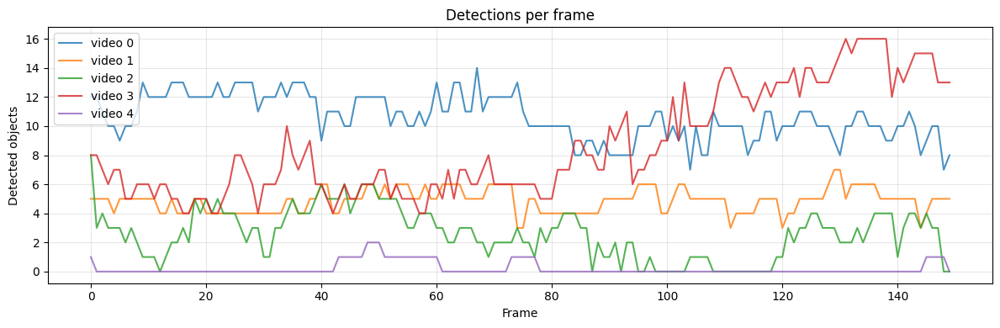 |

| 🏷️ Top detected classes | 🎚️ Confidence by video |
|:---:|:---:|
| 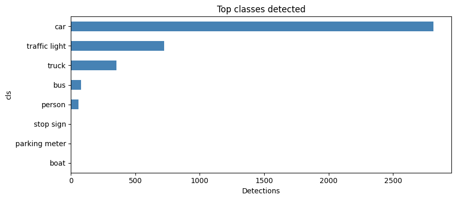 | 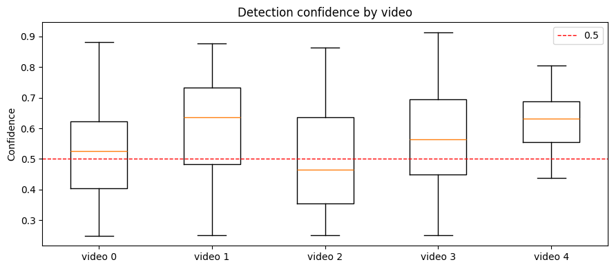 |

| 🔥 Class share per video | ⏱️ Track lifetime |
|:---:|:---:|
| 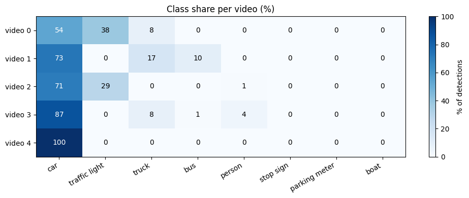 | 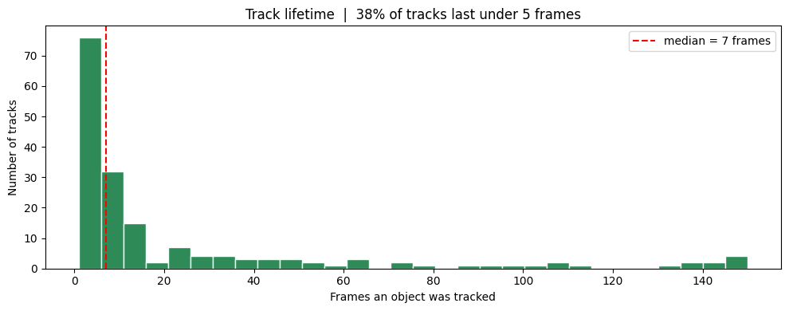 |

</div>

<details>
<summary><b>🖼️ See more charts</b></summary>

<br/>

<div align="center">

| 🆚 Per-video comparison | 📉 Confidence distribution |
|:---:|:---:|
| 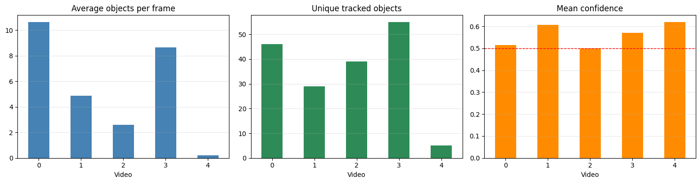 | 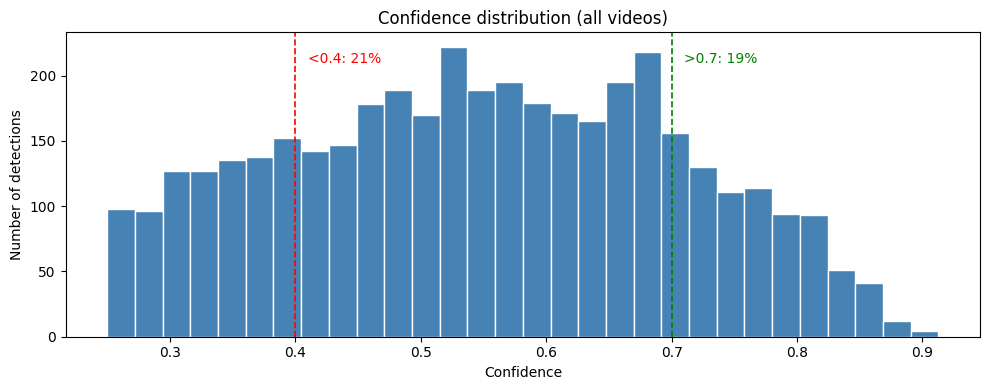 |

| 🎚️ Confidence by class | 🐢 Speed vs scene busyness |
|:---:|:---:|
| 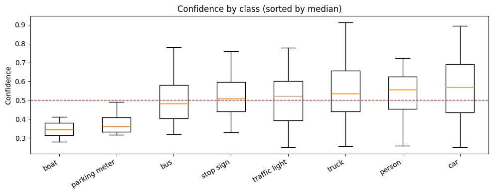 | 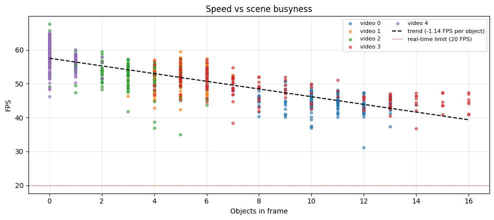 |

</div>

</details>

---

## ⚠️ Limitations

> 🚫 **No ground-truth labels were used.** Precision, recall and mAP are **not** reported, and **detection confidence is not accuracy.**

- 🎲 Only **5 random videos × 150 frames** were analysed, so another random selection can give different numbers.
- 🎚️ Confidence comparisons do not prove generalization.
- 🎯 The thresholds (20 FPS, spread < 0.08, low confidence < 0.4) are this project's own choices.
- 🔁 ID switches cannot be measured without tracking labels; track-lifetime statistics are only a hint.
- 🖥️ FPS depends on hardware (GPU vs CPU).

---

## 🚀 Possible next steps

- [ ] 🏷️ Evaluate with BDD100K ground-truth labels (mAP, precision, recall)
- [ ] 🔬 Compare YOLOv8n with larger models (YOLOv8s / YOLOv8m)
- [ ] 🌙 Analyse day, night and rainy scenes separately
- [ ] 🎯 Evaluate tracking with MOT metrics (IDF1, MOTA)

---

## 📂 Dataset

The project uses the Kaggle dataset **Driving Video with Object Tracking** (BDD100K dashcam videos).

> 📦 The dataset is **not** included in this repository. Obtain it separately (respecting its license) and set `DATASET_PATH` in the notebook.
> 🖼️ *(Optional)* To test your own pictures, set `MY_IMAGES_DIR` to a folder with images you own or may share. If no images are found, those steps are skipped safely.

---

## 💻 Run it yourself

**🟢 Option A – Kaggle (easiest)**
1. Upload `computer-vision.ipynb` to Kaggle.
2. ➕ Add the *Driving Video with Object Tracking* dataset as input.
3. ▶️ Run all cells.

**🔵 Option B – Local**

```bash
# 1️⃣ clone
git clone https://github.com/sabakhalil806-collab/Driving-Scene-Object-Detection.git
cd Driving-Scene-Object-Detection

# 2️⃣ install
pip install -r requirements.txt

# 3️⃣ open the notebook, then set DATASET_PATH and OUT_DIR in Step 2
jupyter notebook computer-vision.ipynb
```

⚙️ **Main settings (Step 2)**

```python
DATASET_PATH = "/path/to/driving-videos"  # 📂 folder with .mov videos
OUT_DIR      = "./outputs"                # 💾 where CSVs and figures are saved
N_VIDEOS     = 5                          # 🎞️ number of videos
MAX_FRAMES   = 150                        # 🖼️ frames per video
CONF         = 0.25                       # 🎚️ detection threshold
```

---

## 🗂️ Repository structure

```text
📦 Driving-Scene-Object-Detection
 ┣ 📓 computer-vision.ipynb   ← main notebook (with saved outputs)
 ┣ 📄 README.md
 ┣ 📄 requirements.txt        ← versions from the successful run
 ┣ 🙈 .gitignore
 ┗ 📂 results/                ← charts from the saved run
```

---

<div align="center">

### 👩‍💻 Author
**[sabakhalil806-collab](https://github.com/sabakhalil806-collab)** · Computer Vision portfolio project

⭐ If you found this useful, please **star** the repository! ⭐


</div>
